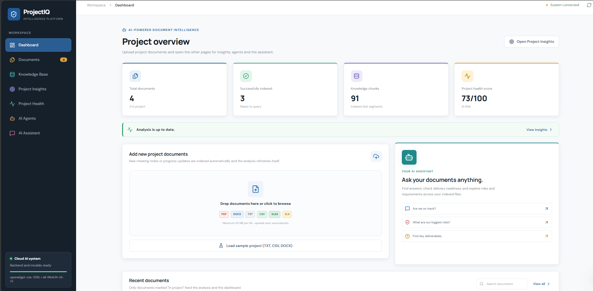
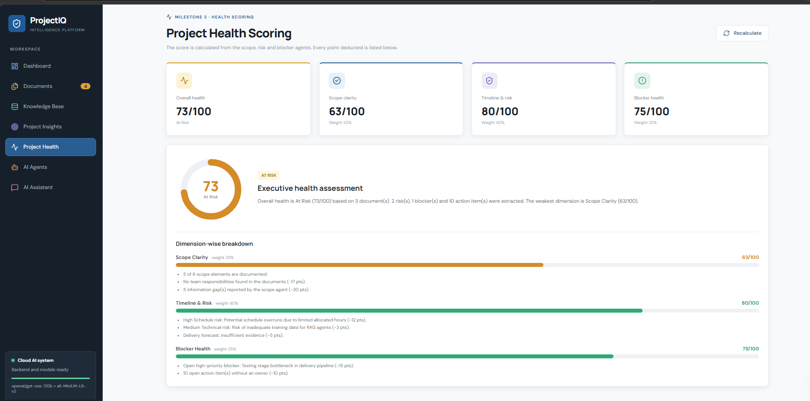
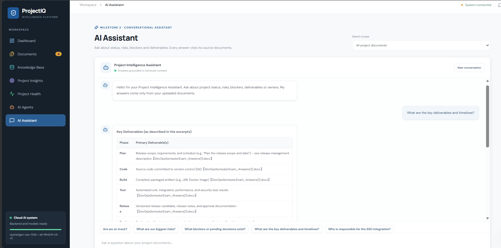

# ProjectIQ: AI Project Intelligence & Risk Advisor

Upload your project documents (PDF, DOCX, TXT, CSV, XLSX) and get a living, queryable view of the project: **scope, risks, blockers, action items, a health score and a chat assistant**, all grounded in the files you uploaded.

Built with **FastAPI, ChromaDB, React (Vite) and a hosted LLM (Groq)**, with Ollama as an offline fallback.



## Features

- **Document ingestion and RAG:** multi-format upload, background indexing, local embeddings (MiniLM) stored in ChromaDB
- **AI agents:** scope and deliverables, risks with severity and mitigation, blockers and pending decisions, action items, delivery forecast
- **Explainable project health score:** weighted by scope clarity, timeline and risk, and blocker health, with every deduction listed on screen
- **Generated documents:** user stories, risk register and action-item report (downloadable as Markdown)
- **AI assistant:** ask questions such as "Are we on track?" or "What are our biggest risks?" and get answers with their sources
- **Incremental updates:** drop in a new file and the dashboard refreshes itself; results are cached and survive restarts
- **Project scope control:** an "In project" switch excludes unrelated files from the analysis and the chat

| Project health | AI assistant |
|---|---|
|  |  |

## Tech stack

| Layer | Technology |
|---|---|
| Frontend | React, Vite |
| Backend | Python 3.11, FastAPI, Uvicorn |
| Vector store | ChromaDB with a local MiniLM embedding model |
| LLM | Groq (default), Gemini or any OpenAI-compatible API, or Ollama offline |

## How it works

```
React (Vite)  -->  FastAPI  -->  ChromaDB (vectors, built-in MiniLM embeddings)
                           \-->  LLM: Groq / Gemini / OpenAI-compatible, or Ollama
                    |
      background pool: extract -> chunk -> embed -> index
                    |
      analysis pipeline (one run, cached): Scope -> Risk -> Blockers -> Health -> Documents
                    |
            analysis_cache.json  -->  GET /api/dashboard (instant)
```

Uploads return immediately and are indexed in the background. Quick actions (delete, toggle, refresh) are merged into a single analysis run, and a run in progress stops at its next stage when documents change. The health endpoint is answered from a cache so the interface never freezes.

## Quick start

**Prerequisites:** Python 3.11+, Node 20.19+ (or 22.12+). Ollama is optional.

**1. Get an API key.** Create a free key in the [Groq console](https://console.groq.com) (API Keys).

**2. Configure the backend.** In `backend/`, copy `.env.example` to `.env` and paste your key after `PROJECTIQ_API_KEY=`.

**3. Run the backend** (PowerShell):

```
cd backend
python -m venv .venv
.venv\Scripts\Activate.ps1
pip install -r requirements.txt
uvicorn main:app --port 8000
```

The first start downloads the small embedding model (about 80 MB, internet needed once).

**4. Run the frontend** (second terminal):

```
cd frontend
npm install
npm run dev
```

Open <http://localhost:5173>. Click **Load sample project** on the dashboard to try it with the bundled sample documents, or upload your own. Interactive API docs are at <http://localhost:8000/docs>.

**Check the model connection:** open <http://localhost:8000/api/llm/test>. It shows the provider and model in use and sends one test request.

> **Model not found?** Hosted providers retire models from time to time (Groq shut down `llama-3.3-70b-versatile` on 2026-08-16). If the app says a model was not found, choose a current model in your provider's console, set `PROJECTIQ_CHAT_MODEL` in `backend/.env`, and restart the backend. The default is `openai/gpt-oss-120b`.

Without an API key the backend falls back to Ollama (`ollama pull llama3.2:3b`). It still works, but each analysis takes minutes on a CPU.

## Health score

Derived from the agent outputs, never from keyword counts. Every deduction is listed on screen.

| Dimension | Weight | Based on |
|---|---|---|
| Scope clarity | 35 % | Which of objective, goals, deliverables, milestones, timeline and responsibilities are documented, minus reported information gaps |
| Timeline and risk | 40 % | Risk severity and category, plus the delivery forecast status |
| Blocker health | 25 % | Open blockers by priority, pending decisions, open actions without an owner |

Overall status: 75 and above Healthy, 50 to 74 At Risk, below 50 Critical. With no agent output the status is "Insufficient Evidence" instead of an invented number.

## Project structure

```
backend/
  main.py                 API, ingestion, RAG chat, scheduling
  pipeline.py             Risk and blocker agents, user stories, orchestrator
  agents/scope_agent.py   Scope and deliverable extraction agent
  health_scorer.py        Explainable weighted health score
  report_builders.py      Risk register, action items, summary (Markdown)
  evidence.py             Relevance-ranked evidence selection
  store.py                Thread-safe persistent cache and pipeline state
  llm.py                  One entry point for all LLM calls, retries, JSON repair
  embeddings.py           Local embedding model and the Chroma collection
  sample_data/            Multi-format sample project
  scripts/                check_llm.py, warm_up.py
  tests/test_core.py      Unit tests (no network or Ollama needed)
frontend/src/             App, hooks, api client, components (Dashboard, Agents, Health, Assistant, ...)
```

## API

| Method and path | Purpose |
|---|---|
| `POST /api/documents/upload` | Accept files, return immediately, index in the background |
| `GET /api/documents` | List documents with status (`processing`, `processed`, `failed`) |
| `PATCH /api/documents/{id}` | Include or exclude a document from the project |
| `DELETE /api/documents/{id}` | Remove a document and its vectors |
| `POST /api/demo/load` | Load the bundled sample project |
| `GET /api/dashboard` | Everything the dashboard needs, from cache |
| `POST /api/analysis/run`, `GET /api/analysis/status`, `GET /api/analysis` | Start, watch and read the analysis |
| `POST /api/agents/{scope,risk,blockers,documentation,health-score}` | Run or fetch a single agent |
| `POST /api/chat` | Question answering over the documents, with sources |
| `GET /api/health` | Model and embedding status |

## Testing

```
cd backend
python -m unittest discover -s tests -v
```

The unit tests need no Ollama and no network. They cover health scoring, report rendering, JSON repair of truncated model output, evidence selection, the cache and staleness logic, and the orchestrator, including partial and total agent failure.

## Configuration (`backend/.env` or environment variables)

| Variable | Default | Meaning |
|---|---|---|
| `PROJECTIQ_API_KEY` | (empty) | Key for the hosted model. When set, the hosted model is used |
| `PROJECTIQ_LLM_PROVIDER` | `groq` if a key is set, else `ollama` | `groq`, `gemini`, `openai` (any OpenAI-compatible service) or `ollama` |
| `PROJECTIQ_CHAT_MODEL` | `openai/gpt-oss-120b` (hosted), `llama3.2:3b` (Ollama) | Model name; use one your provider offers |
| `PROJECTIQ_API_BASE` | provider default | Base URL for `openai`-style services |
| `PROJECTIQ_EMBED_PROVIDER` | `local` | `local` (built-in model) or `ollama` |
| `PROJECTIQ_EMBED_MODEL` | `nomic-embed-text` | Ollama embedding model (only with `ollama` embeddings) |
| `PROJECTIQ_AGENT_CONTEXT_CHARS` | `11000` hosted / `7000` Ollama | Evidence characters given to each agent |
| `PROJECTIQ_LLM_SUMMARY` | `0` | Set to `1` for background LLM document summaries |
| `PROJECTIQ_PARALLEL` | `3` | Agents that call the hosted model at once; set `1` if a free plan answers with rate-limit errors |
| `VITE_API_URL` (frontend) | `http://localhost:8000` | Backend address |

## Known limitations

- Output quality depends on the model. Extraction can miss items or misjudge severity; larger models give better results through `PROJECTIQ_CHAT_MODEL`.
- Scanned PDFs need OCR, which is not included.
- The chat is grounded by prompt and retrieval; it has no hard relevance threshold yet.
- Free hosted plans have rate limits. The client retries automatically, and a smaller model can be chosen.

## Security and privacy

- **Never commit your API key.** Keep it only in `backend/.env`, which is listed in `.gitignore`. Commit `backend/.env.example` (it has no real values) so others know which variables to set.
- The key is read from environment variables; there is no key in the source code.
- Uploaded documents, the vector database and the cached analysis (`backend/uploads/`, `backend/chroma_db/`, `backend/documents.json`, `backend/analysis_cache.json`) stay on your machine and are git-ignored.
- With a hosted model, text excerpts of your documents are sent to that provider. Use the Ollama setting if the documents must stay on your machine.
- If a key is ever pushed by mistake, deleting the file is not enough, because it stays in git history. Revoke it in the provider console, create a new one and update your `.env`.
- When deploying (Render, Railway, Hugging Face Spaces, ...), set `PROJECTIQ_API_KEY` in the host's environment variables or secrets page, not in a file in the repo.

## Author

Venkata Bhavya Sri Veerla, B.Tech in Artificial Intelligence and Data Science, LBRCE Mylavaram.
GitHub: [@bhavyasri8139](https://github.com/bhavyasri8139)


